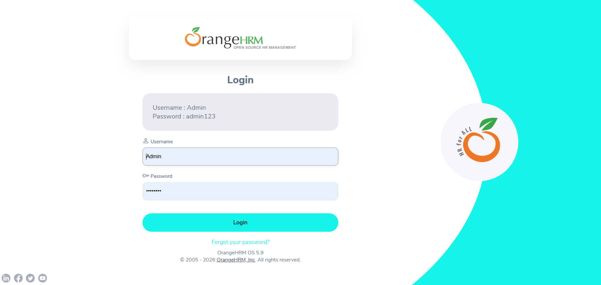
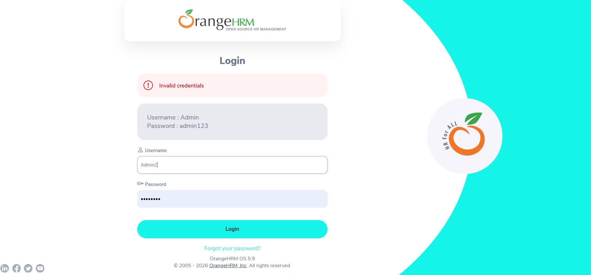
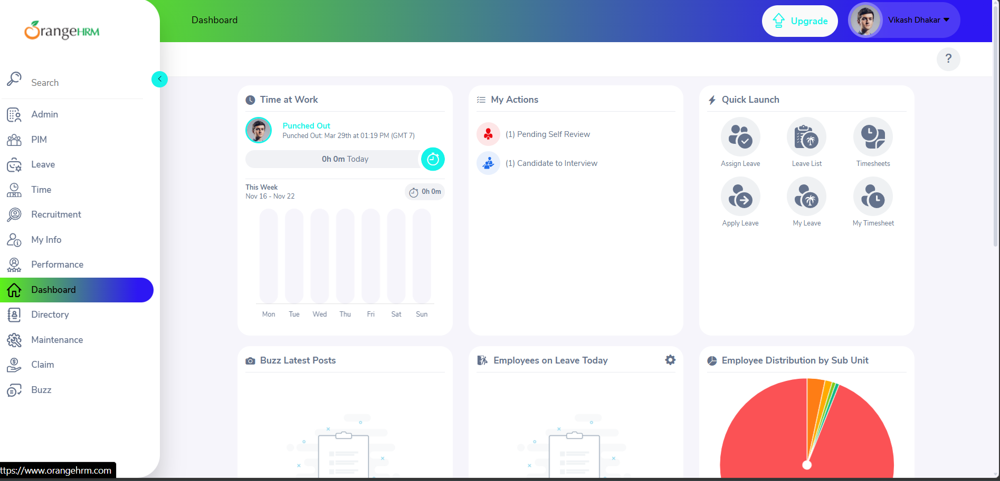
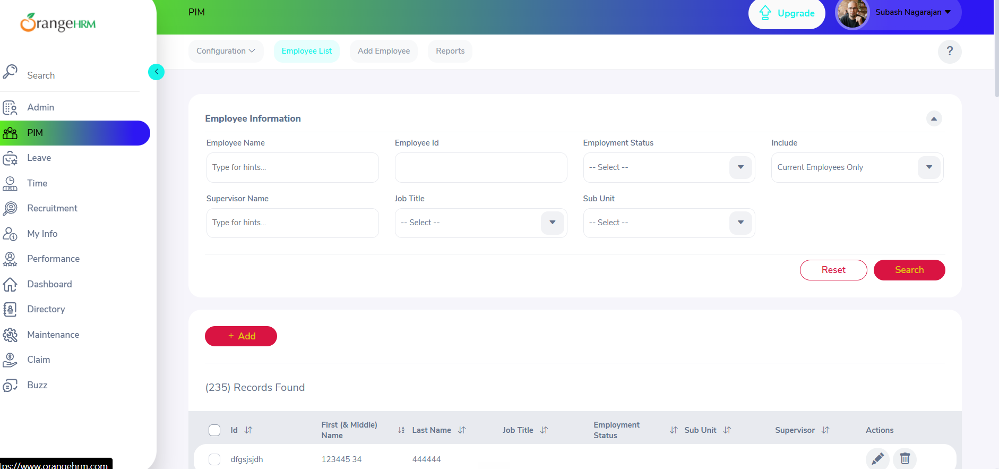
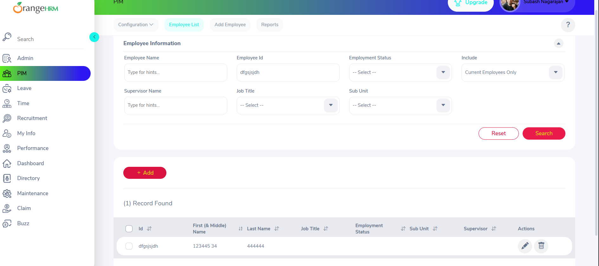
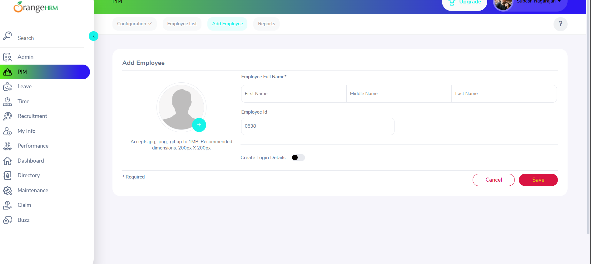
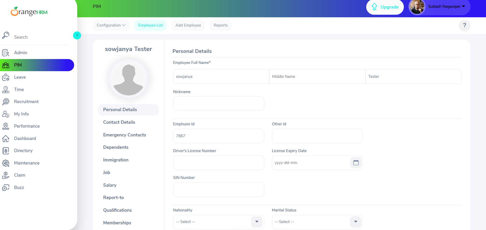

# OrangeHRM Functional Testing Project

## 1. Project Overview

This project focuses on Manual Functional Testing and UI Testing of the OrangeHRM demo web application.

**Application Name:** OrangeHRM  
**Application URL:** https://opensource-demo.orangehrmlive.com/

The objective of this project is to understand how manual testing is performed on a real-world HR management application.

## 2. Project Objectives

- Verify login functionality.
- Validate successful and unsuccessful login scenarios.
- Test dashboard navigation.
- Verify employee information management.
- Validate employee search functionality.
- Test Add Employee functionality.
- Verify Reset functionality.
- Record actual and expected results.
- Document testing evidence using screenshots.

## 3. Application Details

| Details | Description |
|---|---|
| Application | OrangeHRM |
| Testing Type | Manual Testing |
| Testing Approach | Functional Testing and UI Testing |
| Modules Tested | Login and PIM |
| Total Test Cases | 30 |
| Confirmed Bugs | 0 |
| Test Documentation | Microsoft Excel |

## 4. Modules Tested

### 4.1 Login Module
- Verify login with valid credentials.
- Verify login with invalid credentials.
- Validate login error messages.
- Verify login page elements.

### 4.2 Dashboard Module
- Verify successful navigation to Dashboard.
- Check dashboard page display.

### 4.3 PIM Module
- Verify PIM page navigation.
- Validate Employee Information page.
- Search employees by name.
- Search employees by employee ID.
- Test invalid employee search.
- Verify Reset functionality.
- Verify Add Employee page and form fields.

## 5. Testing Types

- **Functional Testing:** Checking whether application features work as expected.
- **UI Testing:** Checking page elements, buttons, input fields and navigation.
- **Positive Testing:** Testing with valid input data.
- **Negative Testing:** Testing with invalid input data.

## 6. Tools Used

| Tool | Purpose |
|---|---|
| Google Chrome | Web application testing |
| Microsoft Excel | Test case preparation and execution results |
| GitHub | Project documentation and storage |

## 7. Test Case Summary

| Test Module | Number of Test Cases |
|---|---:|
| Login Module | 15 |
| PIM Module | 15 |
| **Total** | **30** |

Test cases are documented in separate Excel files.

- [Login Test Cases](Test%20Cases/OrangeHRM_Login_Test_Cases.xlsx)
- [PIM Test Cases](Test%20Cases/OrangeHRM_PIM_Test_Cases.xlsx)

## 8. Screenshots

The following screenshots were captured during manual testing.

### 8.1 Login Page


### 8.2 Invalid Login Credentials


### 8.3 Dashboard


### 8.4 PIM Employee Information


### 8.5 Employee Search Result


### 8.6 Add Employee Page


### 8.7 Employee Personal Details


## 9. Bug Report

A bug report document is included in this project.

- Confirmed Bugs Found: 0
- Bug Report File: OrangeHRM_Bug_Reports.xlsx

No confirmed defects were identified during the testing performed.

[View Bug Report](Bug%20Reports/OrangeHRM_Bug_Reports.xlsx)

## 10. Test Execution Summary

A total of 30 test cases were prepared and executed manually across the Login and PIM modules.

Expected results and actual results were recorded in Excel. Screenshots were captured as testing evidence.

## 11. Project Folder Structure

```text
OrangeHRM-Functional-Testing/
│
├── Test Cases/
│   ├── OrangeHRM_Login_Test_Cases.xlsx
│   └── OrangeHRM_PIM_Test_Cases.xlsx
│
├── screenshots/
│   ├── login-page.png
│   ├── invalid-login.png
│   ├── dashboard.png
│   ├── pim-employee-list.png
│   ├── employee-search-result.png
│   ├── Add-employee-page.png
│   └── employee-personal-details.png
│
├── Bug Reports/
│   └── OrangeHRM_Bug_Reports.xlsx
│
└── README.md
```

## 12. Conclusion

Through this project, I gained practical experience in:

- Understanding a web application.
- Preparing manual test cases.
- Executing test cases.
- Validating expected and actual results.
- Performing positive and negative testing.
- Capturing screenshots.
- Maintaining test documentation.
- Reporting testing results.

**Project Status: Completed**

**Testing Approach: Manual Testing**
